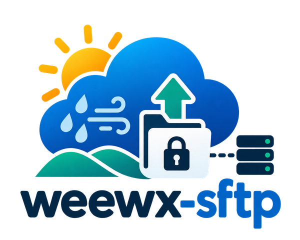

<p align="center">
  
</p>

# weewx-sftp

[](https://github.com/ziti/weewx-sftp/actions/workflows/ci.yml)
[](https://github.com/ziti/weewx-sftp/releases)
[](LICENSE)

> A community-maintained fork of [matthewwall/weewx-sftp](https://github.com/matthewwall/weewx-sftp) (unmaintained). Copyright 2016-2026 Matthew Wall and contributors. Distributed under the terms of the GPLv3.

Report generator for WeeWX that uploads a local directory tree to a remote host
over SFTP. It is functionally equivalent to WeeWX's built-in FTP generator, but
uses the SSH file-transfer protocol.

The SFTP protocol is not the FTPS protocol! FTPS is handled by WeeWX's standard
FTP generator. This generator speaks SFTP via the
[Paramiko](https://www.paramiko.org/) SSH library.

Based on the FTP generator in WeeWX, with help from the SFTP generator
implemented by davies-barnard.

## Requirements

- WeeWX 5.0 or newer
- The `paramiko` Python module, installed into the same environment as WeeWX:

  ```
  pip install paramiko
  ```

  Use paramiko 3.4.0 or newer. Older releases are vulnerable to the Terrapin
  attack (CVE-2023-48795); the generator logs a warning once per process when
  it finds one. Distribution packages may carry a backported fix under an older
  version number; in that case the warning can be ignored.

## Upgrading to 0.9.0 — compatibility warning

Version **0.9.0 changes failure handling and upload-cache behavior**. Review
these changes before upgrading from 0.8 or earlier:

- SSH connection/authentication, SFTP negotiation, and each SFTP blocking I/O
  operation now have a **30-second timeout** by default. Set `timeout` to a
  larger positive number of seconds if your server needs longer. This is an
  inactivity/request timeout, not a deadline for uploading the entire site.
- Exhausted connection, directory-creation, or file-upload retries now fail the
  report. The WeeWX generator logs the failure and allows other reports to run;
  it does not report a successful zero-file transfer or advance the cache.
  Programs calling `SFTPUploader.run()` directly must now handle `OSError`
  instead of expecting `0` when a connection or transfer fails.
- Upload caches now record the destination. **The first successful run after
  upgrading an old cache uploads the full report**, including unchanged assets.
  Changing the server, port, username, or destination path also triggers a full
  upload. Allow for the extra initial transfer. Existing caches are replaced
  atomically only after a successful run.
- Non-regular files, such as FIFOs, fail the report instead of potentially
  blocking it indefinitely. Symlinks to regular files remain supported.
- The command-line uploader now reads the actual WeeWX configuration and skin,
  including inherited paths and private-key options, and returns nonzero on
  failure. It no longer substitutes example credentials or paths for missing
  settings.

Existing option names, password authentication, private-key authentication,
agent/default-key lookup, report definitions, and destination paths remain
supported. Host-key verification remains opt-in for backward compatibility;
configure `known_hosts` below to enable it.

## Installation

1. Install the extension straight from GitHub:

   ```
   weectl extension install https://github.com/ziti/weewx-sftp/archive/refs/heads/main.zip
   ```

   or from a downloaded release archive:

   ```
   weectl extension install weewx-sftp-x.y.zip
   ```

2. Add the SFTP settings to `weewx.conf`:

   ```
   [StdReport]
       [[SFTP]]
           skin = sftp
           enable = true
           user = username
           password = password
           server = host.example.com
           port = 22
           path = /weewx
   ```

3. Restart WeeWX:

   ```
   sudo systemctl restart weewx
   ```

## Options

| Option | Description |
| --- | --- |
| `user` | Remote username. Required. |
| `password` | Remote password. If it contains a comma or space, wrap it in double quotes. Omit when using key authentication. |
| `private_key` | Path to a private key file for key-based authentication. |
| `private_key_pass` | Passphrase for `private_key`, if it has one. |
| `password_env` | Name of an environment variable holding the password, instead of `password`. Setting both is an error. |
| `private_key_pass_env` | Name of an environment variable holding the key passphrase, instead of `private_key_pass`. Setting both is an error. |
| `server` | Hostname or IP address of the remote host. Required. |
| `port` | Port on the remote host. Default is `22`. |
| `path` | Destination directory on the remote host. Required. |
| `max_tries` | Connection and per-file upload attempts. Default is `3`. |
| `timeout` | Positive, finite timeout in seconds for SSH connection/authentication, SFTP negotiation, and SFTP I/O. Default is `30`. |
| `known_hosts` | Optional path to a trusted OpenSSH known-hosts file. When set, only this file is trusted and unknown or changed keys are rejected. `~` is expanded. |
| `allow_agent` | Permit SSH-agent authentication. Default is `true`, preserving existing behavior. |
| `look_for_keys` | Look for default SSH keys. Default is `true`, preserving existing behavior. |
| `log_progress` | Log each file before and after upload at INFO level. Default is `false`; connection/session phases are always logged. Useful for locating a stalled transfer. |

The local directory comes from the standard WeeWX report options `WEEWX_ROOT`
and/or `HTML_ROOT`; if unset here they are inherited from `[StdReport]`.

Without `known_hosts`, unknown keys are still accepted automatically, matching
the original behavior. This does not establish the server's identity. To use a
specific private key and reject untrusted servers, configure a trusted host key
obtained through an independently verified channel:

```ini
[StdReport]
    [[SFTP]]
        skin = sftp
        enable = true
        server = host.example.com
        user = publisher
        private_key = /home/weewx/.ssh/publisher_key
        known_hosts = /home/weewx/.ssh/known_hosts
        allow_agent = false
        look_for_keys = false
        path = /reports
        timeout = 30
        log_progress = true
```

Omit `password` when using key-only authentication. Ensure the WeeWX process
can read the private key and known-hosts file. For a nonstandard SSH port, the
known-hosts entry uses OpenSSH's `[host.example.com]:PORT` hostname notation.

### Keeping secrets out of weewx.conf

`weewx.conf` is often readable by more accounts than the WeeWX service, or ends
up in backups and support requests. Instead of `password` or
`private_key_pass`, you can name an environment variable with `password_env`
or `private_key_pass_env`:

```ini
[StdReport]
    [[SFTP]]
        server = host.example.com
        user = publisher
        password_env = WEEWX_SFTP_PASSWORD
        path = /reports
```

With systemd, provide the variable through a drop-in
(`sudo systemctl edit weewx`) that reads a root-only file:

```ini
[Service]
EnvironmentFile=/etc/weewx/sftp.env
```

where `/etc/weewx/sftp.env` (mode `0600`) contains
`WEEWX_SFTP_PASSWORD=...`. If the named variable is unset or empty, the report
fails with a configuration error that names the variable but not its value.
For the command-line uploader, export the variable in the calling shell.

To run one report directly with its effective skin settings:

```sh
PYTHONPATH=bin python bin/user/sftp.py --config /path/to/weewx.conf --report SFTP --debug
```

The command performs a real upload. Avoid running it alongside the same
scheduled report. It exits with status `0` only after a successful upload and
cache save; otherwise it exits nonzero. Logs identify connection/session stages,
the active file when progress logging is enabled, and failures. They do not
print configured passwords or private-key contents.

## Development

```
pip install -r requirements-dev.txt
ruff check .
pytest
pip install weewx paramiko
python tests/integration_sftp.py
```

The real integration tests use only loopback SSH/SFTP, generated temporary keys,
and temporary report files. They cover public-key uploads, incremental and
destination-aware caches, a server that stalls after SSH authentication, a
stalled file request, and the actual command-line uploader. They run separately
from unit tests so the unit-test Paramiko fake cannot mask protocol behavior.

Tag a commit `vX.Y.Z` -- matching `VERSION` in `bin/user/sftp.py`, `version` in
`install.py`, and the top line of `changelog` -- and the release workflow builds
`weewx-sftp-X.Y.zip` and publishes it to GitHub Releases.
